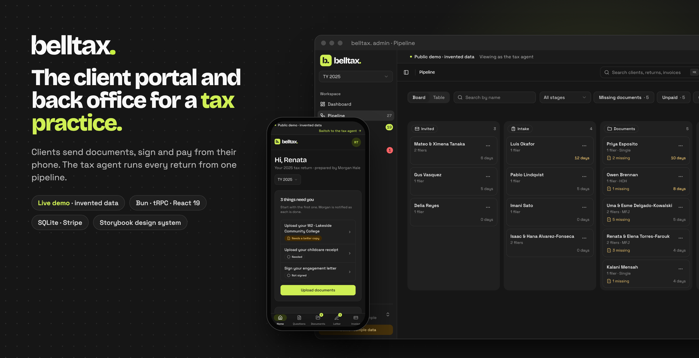
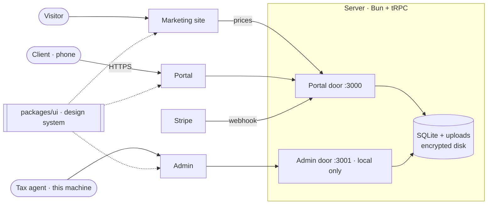

<a href="https://belltax-demo.onrender.com/sign-in"></a>

<br>

<picture>
  <source media="(prefers-color-scheme: dark)" srcset="packages/ui/src/brand/bell-wordmark-dark.svg">
  
</picture>

<p>
  <a href="https://github.com/yeahitsmejayyy/belltaxprep/actions/workflows/ci.yml"></a>
  <a href="https://github.com/yeahitsmejayyy/belltaxprep/actions/workflows/chromatic.yml"></a>
  <a href="https://belltax-demo.onrender.com/sign-in"></a>
  <a href="https://main--6acc3e31a2af6c6973a2ed80.chromatic.com"></a>
  <a href="LICENSE"></a>
</p>
<p>
  
  
  
  
  
  
  
</p>

A client portal and a back office for a small tax practice. Clients answer questions, send documents, sign the
engagement letter and pay from their phone; the tax agent runs every return from one pipeline. It handles
everything around a tax return except the return itself, which stays in professional tax software (Intuit ProSeries).
It is built to run real clients in the 2027 filing season, so it treats client data the way a paid preparer is
required to: see [two data worlds](docs/two-data-worlds.md) and the [security plan](docs/wisp.md).

**Try it:** [belltax-demo.onrender.com](https://belltax-demo.onrender.com/sign-in) — pick "See it as a client" or
"See it as the tax agent". Everything there is invented and resets every six hours. Pay an invoice with the Stripe
test card `4242 4242 4242 4242`. (Free hosting: the first visit can take up to a minute to wake.)

| | |
|---|---|
| **Demo** (portal + admin) | [belltax-demo.onrender.com](https://belltax-demo.onrender.com/sign-in) |
| **Marketing site** | [belltaxprep.vercel.app](https://belltaxprep.vercel.app) |
| **Design system** | [Storybook](https://main--6acc3e31a2af6c6973a2ed80.chromatic.com), published by Chromatic on every push |
| **Case study** | [docs/case-study.md](docs/case-study.md) |
| **3-minute demo script** | [docs/demo-script.md](docs/demo-script.md) |

## What's in it

- **Client portal** (`apps/portal`): phone first. Where the return stands, an intake questionnaire that saves as you
  go, document requests with uploads, the engagement letter with an e-signature, the invoice with Stripe checkout,
  receipts, and the client's own settings.
- **Tax agent admin** (`apps/admin`): a drag-and-drop pipeline across eight stages, an inbox of what clients sent,
  document review, invoices and payments, e-file status recorded from ProSeries, search (⌘K), activity, pricing and
  practice settings, and a new-season rollover.
- **Server** (`apps/server`): Bun, tRPC and zod over SQLite, with numbered migrations, encrypted backups, an offline
  export of each household's record, retention purges, and a Stripe webhook.
- **Marketing site** (`apps/site`): one static page that reads its prices and practice details from the server, so
  they live in one place.
- **Design system** (`packages/ui`): tokens, shadcn primitives and product components shared by all three apps,
  with stories, interaction tests and accessibility checks in Storybook. The rules behind it are in
  [`principles.md`](principles.md).

## Decisions worth talking about

- **Two data worlds.** Real client data and demo data never meet. The repo, the hosted demo and every screenshot
  hold invented households only; the live instance runs on one machine the preparer controls. Code enforces it: live
  mode refuses to start with its data inside the repo or on an unencrypted disk, and CI fails on anything tracked that
  looks real (databases, documents, an SSN outside the never-issued 9xx range).
- **The admin never faces the internet.** One server, two listeners on `127.0.0.1`: the portal (the only port a tunnel
  may forward) and the admin. Preparer procedures don't exist on the portal at all; they answer exactly like a path
  that was never defined, even with a preparer's credentials. The hosted demo mounts the admin at `/admin/` on one
  port, and only in demo mode.
- **A mailbox, not a vault.** The portal stores the last four digits of an SSN and no bank details; full numbers live
  in ProSeries. Uploads are kept only as long as the season needs them, then purged, with the record the law asks for
  exported encrypted to offline storage.
- **The database refuses what must never be true.** One original return per filer per year, a signature tied to the
  exact text it signed, totals derived from line items, an audit log that can't be edited: these are CHECKs, partial
  unique indexes, composite keys and triggers, so no code path can get around them. Workflow rules ("don't prepare
  before every filer signs") are stage gates in the API, with readable errors.
- **Authorization first.** Every client request goes through one access check, and denials are "not found", so a
  stranger can't even learn that a record exists. Tests that try to reach another household were written before the
  features they protect.
- **One design system for three apps.** Tokens in CSS, components in `packages/ui`, apps import them and never copy.
  Storybook is the catalogue and the test bench: every component has stories, a hidden test twin runs its
  interactions, and axe checks accessibility.

## Running it

Needs [Bun](https://bun.sh) 1.3.

```bash
bun install
bun run dev          # server: portal on :3000, admin on :3001; re-seeds 25 invented households
bun run dev:portal   # client portal on :5173
bun run dev:admin    # tax agent admin on :5174
bun run dev:site     # marketing site on :5175
bun run storybook    # design system on :6006
```

Before pushing, the same four checks CI runs:

```bash
bun run check:data && bun run typecheck && bun test && bun run build
```

Stripe is optional and test mode only; see [docs/stripe.md](docs/stripe.md). The hosted demo is a Docker image on
Render plus a static site on Vercel; see [docs/demo-deploy.md](docs/demo-deploy.md).

## How it fits together



| Path | What |
|---|---|
| `apps/server` | Bun + tRPC + zod + SQLite. Routes, access checks, migrations, seed, backups, export, Stripe |
| `apps/portal` · `apps/admin` · `apps/site` | React 19 + Vite + Tailwind v4 |
| `packages/ui` | Tokens, components, brand, Storybook stories |
| `packages/schema` | Shared zod schemas and the intake questionnaire |
| `docs/` | Data worlds, security plan, runbooks, migrations, performance, deploy |

## Quality

- 457 server and schema tests (`bun test`), including access, surfaces, the public demo and the Stripe webhook.
- 160+ Storybook stories run as tests in Chromium with interaction checks; Chromatic snapshots every story.
- Typecheck across six packages; a dependency audit that fails on high or critical advisories.
- A scale check at 2,000 households with a 100 ms budget per hot path ([docs/performance.md](docs/performance.md)).

## About

Designed and built by PJ Bell, a CTEC Registered Tax Preparer, to run Bell Tax.
Every name, number and document in this repository and the demo is invented.

## License

[MIT](LICENSE). The code is free to reuse; the belltax. name and brand marks are not part of the license.
