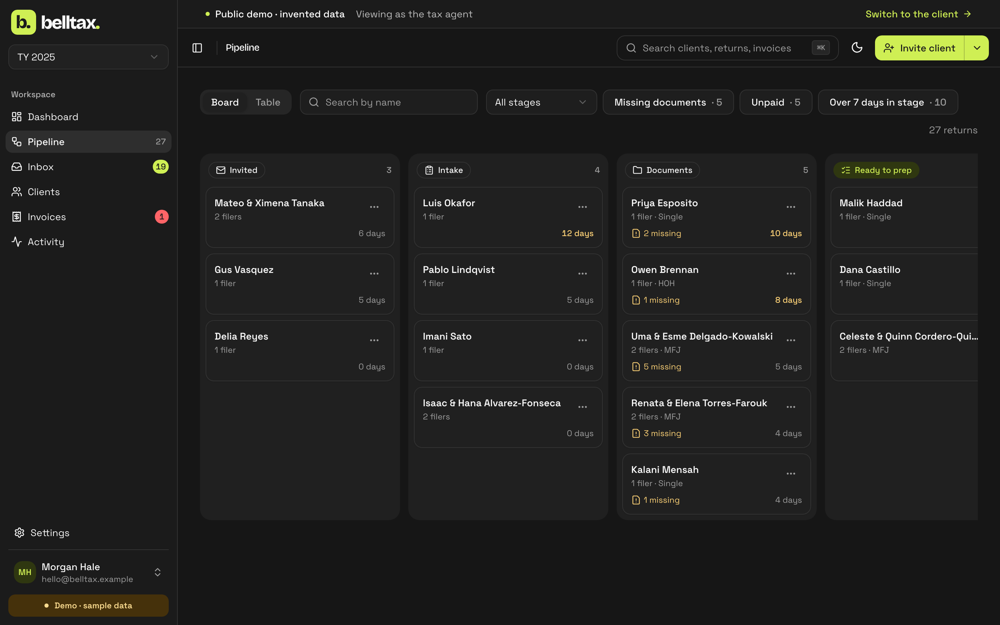
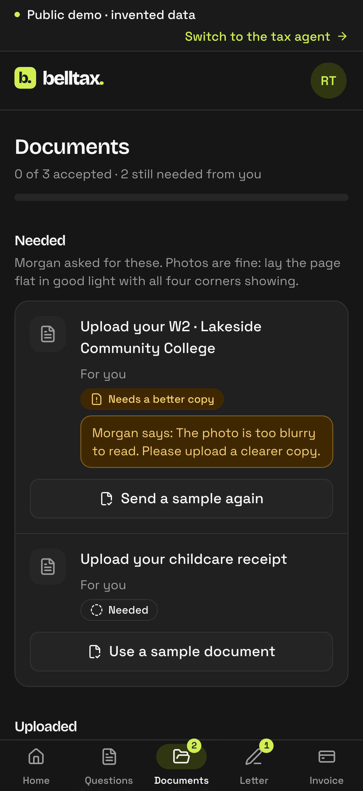
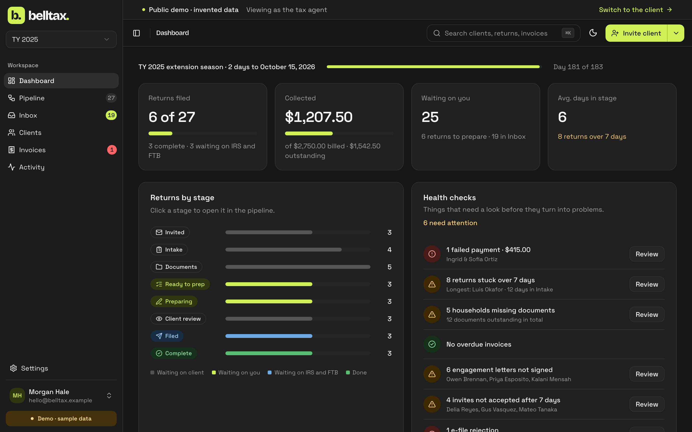

# Case study: belltax.

A client portal and back office for a one-person tax practice, built to run real clients in its first filing season
and to be shown in public at the same time. Live demo: [belltax-demo.onrender.com](https://belltax-demo.onrender.com/sign-in).

## The problem

A small tax practice runs on email, text messages and paper. Clients send W-2s as photos in a text thread, forget
which documents are still missing, sign the engagement letter on paper, and pay by Zelle with no receipt. The preparer
spends the season chasing: who sent what, who still owes what, which returns are stuck and why.

Professional tax software (here, Intuit ProSeries) prepares and e-files the return well. Everything around the return
is left to the preparer: collecting information, tracking progress, the agreement, getting paid.

## Constraints

- **Real clients, first season.** It goes live for the 2027 filing season (January to April). Whatever ships has to
  work with real Social Security numbers and real money, run by one person.
- **The law applies from day one.** A paid preparer counts as a financial institution: the FTC Safeguards Rule
  requires a written information security program, IRC §7216 makes misuse of return information a crime, and
  California adds its own preparer and breach-notice rules.
- **It's also a public portfolio piece.** The code and a live demo have to be shareable without ever exposing a client.
- **One maintainer.** No ops team, no on-call. Anything that needs babysitting is a risk.
- **Clients use phones.** Most will never open the portal on a laptop.

## Approach

**Draw the line between real and demo once, and make code enforce it.** The repo, the hosted demo, Storybook and
every screenshot use 25 invented households. The live instance runs on one machine the preparer controls. Live mode
refuses to start with its data inside the repo or on an unencrypted disk, and CI fails on any tracked file that looks
like client data. The rule needs no discipline to keep.

**Hold as little as possible.** The portal stores the last four digits of an SSN and never a bank account. Full
numbers live in ProSeries. Uploaded documents are kept for the season, then purged; the record the law requires is
exported, encrypted, to offline storage. A server holding a few weeks of uploads is a smaller target than one holding
every W-2 since 2027. The [security plan](wisp.md) sets out the full reasoning.

**Keep the back office off the internet.** One server, two listeners, both on `127.0.0.1`. Only the portal can be
reached, through an outbound tunnel. The admin's procedures don't exist on the portal at all, even for a preparer's
credentials. The smallest attack surface is the one with nothing on it.

**Let the database refuse what must never happen.** The schema was designed before any screen: households as
accounts, returns as yearly snapshots of who filed and who was claimed, so past years never change. Invariants are
constraints and triggers, not conventions: one original return per filer per year, a signature bound to the hash of
the exact text signed, totals derived from line items, an audit log that can't be edited. Workflow rules that change
with the business are stage gates in the API instead, where they can explain themselves.

**Design system first, for three apps.** Tokens, principles and components came before the screens, in a shared
package with Storybook as catalogue and test bench. The portal, the admin and the marketing site import the same
pieces, so a change to the brand or a contrast fix lands everywhere at once.

## Trade-offs

- **SQLite, one machine.** No managed database, no replication. It suits a practice with a few hundred clients and
  makes "where does the data live" a one-line answer. The cost is that backups and a restore drill are the preparer's
  job; there are commands and a runbook for both.
- **No SDK for Stripe.** Two REST calls and a signature check instead of a dependency. Less to audit; more to own.
  Card details never reach the server either way, because payment happens on Stripe's hosted page.
- **A demo that's honest about itself.** The public demo can't accept uploads, because anyone could send a real W-2.
  Instead the server draws an invented sample document that goes through exactly the same path. It's less flashy than
  a real upload, and it's the only safe version.
- **Free hosting for the demo.** Render's free plan sleeps, so the first visit can take a minute. Fine for now;
  one click upgrades it.
- **Sign-in comes last.** Real authentication (invite links, argon2id, sessions, MFA for the preparer) is the next
  ticket, not the first. Until it ships, live mode serves no client data at all, so the order is safe.

## Results

- Three apps on one design system, deployed: portal and admin on Render, the site on Vercel, Storybook on Chromatic.
- 457 server tests and 160+ Storybook tests on every push, plus typecheck, a dependency audit and a data check.
- A scale check at 2,000 households, with every hot path under a 100 ms budget.
- A written information security plan mapped to the Safeguards Rule, with each control marked in place, planned, or
  owner to-do.

## What's next

1. **Sign-in:** invite links, passwords, sessions, and MFA for the preparer.
2. **The tunnel** to put the portal online for real clients, forwarding the portal port only.
3. **Mailbox retention:** shorten portal storage to weeks and export each season to the offline vault.
4. **A dry run** of a full season on the live machine with invented households, then two or three friendly clients in
   January.
